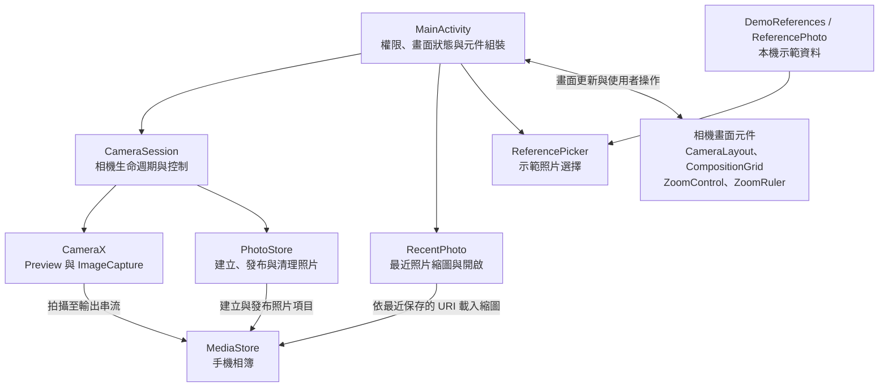

# Photo Copilot 架構

本文件說明目前的程式責任與資料流程，以及尚未實作功能的接入方式。環境設定、操作與檢查指令見 [README.md](README.md)。

## 整體結構

目前採用單一 repository、單一 Android `app` 模組，以 Java／XML Views 開發，按功能分 package。`backend/` 另提供 Python／FastAPI 攝影參考推薦 MVP；Android 目前仍全部在手機本機執行，尚未接入後端。



## 模組責任

Java 根 package：`com.yrf3.photocopilot`，位於 `frontend/app/src/main/java/`。

| 位置／類別 | 責任 |
| --- | --- |
| `MainActivity` | 權限請求與設定入口、組裝元件、連接使用者操作與相機回呼、保存畫面狀態 |
| `camera/CameraSession` | CameraX 啟動與停止、預覽與拍攝、鏡頭切換、縮放與閃光能力、相機錯誤及預覽方向 |
| `camera/PhotoStore` | 建立照片 URI 與輸出串流、發布成功照片、清理未完成照片、記錄最近保存的 URI |
| `camera/RecentPhoto` | 背景載入最近照片縮圖、修正顯示方向、交由外部圖片檢視器開啟 |
| `camera/CameraLayout` | 在系統列及螢幕缺口的安全範圍內，維持控制項的裝置相對位置 |
| `camera/CompositionGrid` | 按實際預覽影像範圍繪製九宮格，排除黑邊 |
| `camera/ZoomControl`、`camera/ZoomRuler` | 常用倍率、拖動細調刻度、鍵盤與無障礙操作 |
| `reference/ReferencePhoto` | 示範照片的穩定 ID、本機圖片 URI 與無障礙描述 |
| `reference/DemoReferences` | 集中提供四張內建示範照片 |
| `reference/ReferencePicker` | 底部選擇面板、縮圖載入、選取／清除、空資料及載入失敗狀態 |

版面、圖示、字串與圖片沿用 `frontend/app/src/main/res/`；專案已移除測試原始碼及專用依賴。

## 目前資料流程

### 權限與預覽

1. `MainActivity` 在進入畫面或返回前景時檢查實際相機權限。
2. 首次使用直接呼叫 Android 系統權限視窗；拒絕後顯示手動重試或設定入口。
3. 授權後由 `CameraSession` 取得 `ProcessCameraProvider`，優先使用後置鏡頭，沒有時使用前置鏡頭。
4. `Preview` 與 `ImageCapture` 一起綁定 Activity 生命週期；預覽真正進入串流狀態後才開放拍攝。

### 拍攝與保存

```text
快門 → MainActivity 檢查權限與拍攝狀態
     → CameraSession 請求拍攝
     → PhotoStore 建立 URI 與輸出串流
     → CameraX ImageCapture 寫入 JPEG
     → PhotoStore 發布照片並記錄最近 URI
     → MainActivity 恢復控制，RecentPhoto 更新縮圖
```

- 保存位置為 `Pictures/PhotoCopilot`，使用唯一檔名。
- Android 10 以上以 `RELATIVE_PATH` 與 `IS_PENDING` 管理保存；Android 8／9 使用公開圖片目錄及儲存權限。
- 建立、寫入及發布照片均在背景執行；失敗時刪除本次的未完成 URI。
- 拍攝中停用快門、切鏡、縮放與閃光，避免重複操作。

### 示範照片選擇

```text
DemoReferences → List<ReferencePhoto> → ReferencePicker
使用者選取 → 保存選擇 ID → 更新入口縮圖 → 返回相機
```

圖片隨 App 放在 `res/drawable-nodpi/`，由背景執行緒取樣解碼成縮圖。空列表或載入失敗會顯示提示，失敗圖片不可選。這個流程目前只管理選擇狀態，未包含場景分析、排序或輪廓疊圖。

## 後端參考推薦 MVP

2026-10-28：先採 SigLIP 2 整圖向量建立內容相關性的基線，以可編輯的拍法標籤衡量多樣性。美感篩選由圖庫提供者在入庫前完成，後端不另建立審核系統。本版不要求先實作場景描述、LLM 或 Android 連線。

```text
離線：圖庫 JSON 中已批准的圖片 → 共用編碼／圖片指紋 → .npy 向量及 JSON 新世代
     → 完整寫入並校驗 → 原子替換 current.json
查詢：POST /recommend 圖片 → 相同編碼 → cosine 候選最多 200 張
     → 相關性門檻 → 保守去重 → 拍法覆蓋貪婪重排 → 預設最多 6 張及參考理由
```

執行程式集中在 `backend/photocopilot/`，沒有為未實作的功能預建 package。後端的開發依賴只保留 Ruff，正式環境以 `--no-dev` 安裝。

| 檔案 | 責任 |
| --- | --- |
| `api.py`、`service.py` | HTTP 上傳／圖片讀取、大小限制、推薦流程及執行緒同步 |
| `encoder.py` | 有限大小的圖片解碼、EXIF／RGB、SigLIP 2 編碼、前處理簽章與去重指紋 |
| `store.py` | NumPy 精確 cosine 搜尋、向量與照片資料對應校驗、模型簽章、整批索引發布及載入 |
| `ranking.py`、`domain.py` | 相關性門檻、去重、固定尺度的拍法覆蓋及貪婪選圖 |
| `catalog.py`、`index.py` | JSON 圖庫載入、批准／示例邊界、離線批次建庫 |
| `config.py`、`config.toml` | 共用配置、可調權重／門檻與相對路徑規則 |

索引與查詢使用相同的固定模型版本及前處理；簽章不同時要求重新建庫。內容向量不直接當作多樣性特徵；拍法未知標籤不提供覆蓋獎勵。高相似度本身不表示同圖，近似去重還需要圖片指紋證據，已知不同拍法予以保留。

2026-10-30：儲存層由本機 Qdrant 改為 NumPy 精確搜尋，適用於偶爾整批更新的圖庫。`index_path` 指向 `.data/numpy-index/`。每個完整世代包含 float64 L2 正規化 `.npy` 矩陣，以及按列對應的照片 JSON（ID、路徑、標籤、去重指紋及模型簽章）；`current.json` 保存檔案雜湊並原子切換目前世代。啟動時檢查完整性、資料列數／維度、唯一 ID、有限且正規化的向量，以及模型簽章，避免錯配或混用。

API 啟動時一次載入索引，查詢以正規化向量內積計算 cosine，沿用門檻及候選上限；門檻含等於值，相同分數按 ID 穩定排序。離線重建不會修改已載入的快照，正在運行的 API 繼續使用舊世代，重新啟動後才採用新世代。沒有 Qdrant 的單程序目錄鎖；預設仍用一個 worker，因為每個 worker 都需要自己的模型與索引記憶體。

儲存邏輯集中在 `store.py`，API、SigLIP 2、去重及拍法重排的責任維持原樣。原始照片、圖庫資料及模型快取繼續使用；舊 Qdrant 索引與備份已按使用者要求移除，現行依賴與配置不包含 Qdrant。圖片上傳不保存，也不傳往外部推論服務。API 與模型／資料檔案在電腦本機運行，尚未測試公開部署。

隨附示例包含食物、人像及風景，但不是正式美感篩選資料。需以 `--allow-demo` 明確啟用，結果包含 `demo: true`。獨立取景圖片的相關性、拍法覆蓋與延遲仍需正式圖庫及人工評估。啟動和檢查見 [backend/README.md](backend/README.md)。

## 狀態、生命週期與畫面規則

- **畫面重建**：以 Bundle 保存鏡頭、閃光、倍率、九宮格、所選示範照片 ID、面板開啟及等待權限結果的狀態；不保存 Bitmap。示範照片選擇不是永久偏好設定。
- **權限狀態**：SharedPreferences 只記錄曾否詢問，用於決定提示方式；每次返回仍以系統實際權限為準，旋轉時不重複請求。
- **相機生命週期**：由 CameraX 綁定 Activity 管理背景停止及前景恢復；過期的非同步啟動或控制回呼不更新新狀態。
- **保存生命週期**：保存使用 application context 與共用背景執行緒，已開始的保存可在 Activity 銷毀後收尾或清理，回呼不更新已銷毀畫面。系統終止 App 時不保證保存完成。
- **最近照片**：只持久保存本 App 最近成功拍攝的 URI，不掃描整個相簿；Android 8／9 的縮圖方向由 ExifInterface 處理。
- **預覽**：使用 CameraX `FIT_CENTER` 保持比例及 `COMPATIBLE` 模式；黑邊不繪製九宮格，也不以拉伸影像填滿畫面。
- **旋轉**：控制項以裝置原本方向固定排列，只轉動圖示、文字與縮圖；預覽容器補償畫面方向，CameraX 處理影像方向。顯示監聽同步預覽的 target rotation，涵蓋不重建 Activity 的 180° 旋轉。
- **能力限制**：縮放限制在鏡頭回報範圍；切鏡重設為 1×，不支援閃光時關閉並停用控制。閃光使用拍照模式，不是常亮手電筒。

## 待實作功能與接入邊界

以下為後續設計方向，表中的能力與介面尚未實作；現有 `reference` package 只負責示範照片選擇。

| 功能 | 建議位置 | 主要輸入 → 輸出 |
| --- | --- | --- |
| 場景分析 | `scene` | 相機快照 → 可由使用者修改的場景描述 |
| 參考推薦 | `reference` | 快照／場景與使用者條件 → 排序照片、ID、標籤及可選輪廓 |
| 輪廓疊圖 | `reference` | 所選參考 → 可移動、縮放的預覽疊圖 |
| 構圖建議 | `guidance` | 當前影像／感測資訊與可選參考 → 動作提示與理由 |
| 相機參數建議 | `guidance` | 場景與裝置支援範圍 → 可用設定及理由，經使用者確認後套用 |

預期流程：

```text
相機快照 → 場景分析 → 使用者確認／修改場景 → 參考推薦 → 選擇參考 → 輪廓疊圖
當前影像／感測資訊 + 可選參考 → 構圖建議
場景 + 裝置支援範圍 → 參數建議 → 使用者確認 → 套用
```

參考推薦已先採 SigLIP 2／NumPy 精確搜尋基線；其他模型、檢索改進及本機／遠端分工，仍按效果、延遲、記憶體、網絡依賴與成本作實驗比較。

### 接入規則

- Activity 負責畫面及流程組裝，模型、HTTP 或檢索邏輯放在對應功能內。
- 開始實作功能時才定義介面與資料型別，依賴方向為「畫面／流程 → 功能介面 ← 本機或遠端實作」。先以明確標示的假資料接通，再替換為實際算法。
- 場景分析需要影像輸入時，再接入 CameraX `ImageAnalysis`；目前只有 `Preview` 與 `ImageCapture`。
- 分析先由使用者觸發；影像處理、檢索及網絡操作不阻塞 UI。以請求 ID 忽略過期回應，離開畫面後取消或忽略未完成結果。
- 手動修改場景後重新推薦，保留使用者的修改，直到使用者重新啟用自動更新。
- 提供載入中、空結果、成功及失敗狀態；分析或推薦失敗時，基本相機仍可使用。
- 遠端推薦後端已建立；接入 Android 時再加入傳送資料說明、逾時與取消，沿用既有後端圖片大小限制。API key 留在服務端。
- 算法比較實驗有需要保存時才建立 `experiments/`，記錄執行方式及量測結果。模型權重與研究影像另行管理。

## 後續開發次序

1. 在真機補驗基本相機、權限、旋轉及保存流程。
2. 準備正式圖庫與獨立查詢圖，校準推薦門檻、去重及拍法權重，評估效果和延遲。
3. 將 Android 取景及參考面板接入推薦 API，再接通輪廓疊圖／移動／縮放，按需要補場景編輯及模型比較。
4. 加入構圖與參數建議，再進行整合及用戶評估。

每次改動依功能選擇建置、lint、API 操作及真機檢查；指令與驗證限制見 README。架構改變時更新本文件，保留已實作與待實作的區分。
